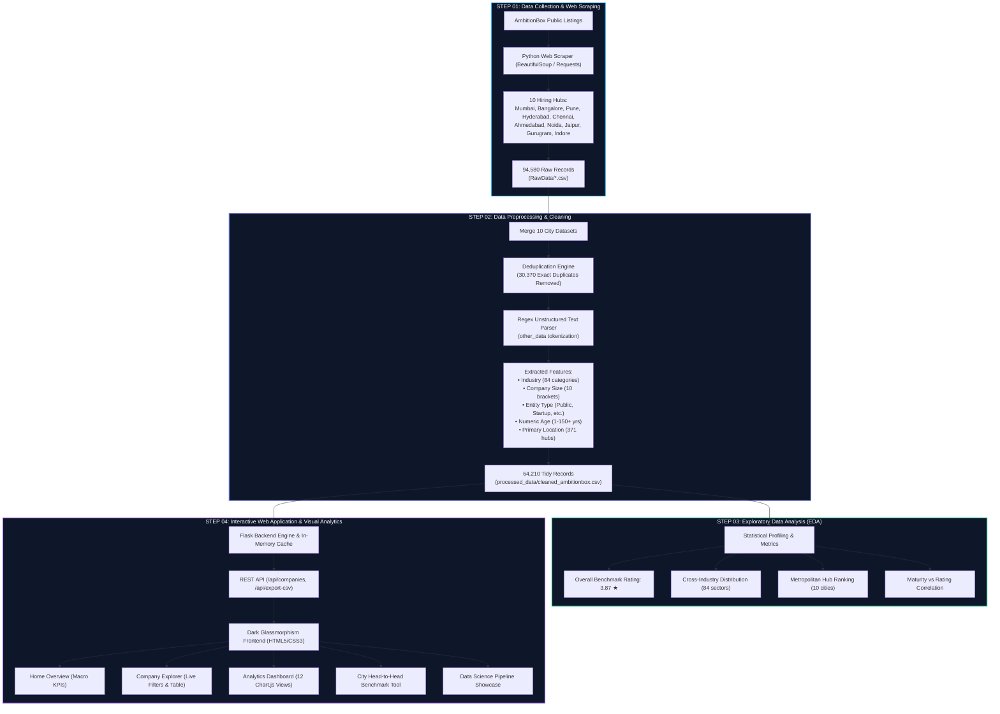

# 📊 AmbitionBox City Workplace Analytics Dashboard

[](https://www.python.org/)
[](https://flask.palletsprojects.com/)
[](https://pandas.pydata.org/)
[](https://getbootstrap.com/)
[](https://www.chartjs.org/)
[](#)

> **A fast, interactive lens on AmbitionBox company listings across India.** Filter and analyze **64,210 companies** across **84 industries** and **371 locations** in real time with an ultra-modern dark glassmorphism dashboard.

---

## 🚀 Visual Project Lifecycle & Pipeline



---

## 📌 End-to-End Project Steps Breakdown

### 🌐 Step 01: Data Collection (Web Scraping)
- **Sources**: AmbitionBox company profiles and review directories across India.
- **Coverage**: 10 primary metropolitan hiring hubs:
  - *Ahmedabad, Bangalore, Chennai, Gurugram, Hyderabad, Indore, Jaipur, Mumbai, Noida, Pune*.
- **Volume Extracted**: **94,580 raw listings** saved into city-specific CSV files under `RawData/`.
- **Raw Schema**:
  - `company_name`: Corporate entity name
  - `company_rating`: Aggregated employee review score (1.0 to 5.0)
  - `other_data`: Comma-separated unstructured listing text
  - `city`: Hiring hub origin

---

### 🧹 Step 02: Data Preprocessing & Transformation
- **Concatenation**: Merged all 10 city datasets into a unified master repository.
- **Deduplication**: Companies operating across multiple cities created overlapping entries. We performed multi-column subset deduplication:
  $$\text{Deduplication Target: } 94,580 - 30,370 = 64,210 \text{ unique, tidy records}$$
- **Unstructured Text Parsing**: Transformed tangled strings like:
  ```text
  "Pharma , 10k-50k Employees , Public , 72 years old , Ahmedabad +152 more"
  ```
  into 5 clean, type-cast features:
  - **`industry`**: e.g., `Pharma` (normalized across 84 verticals)
  - **`size`**: e.g., `10k-50k` (standardized employee tiers)
  - **`type`**: e.g., `Public`, `Startup`, `Fortune India 500`, `Forbes Global 2000`
  - **`age`**: e.g., `72` (numeric integer years in operation)
  - **`location`**: e.g., `Ahmedabad` (extracted primary hub)
- **Missing Value Imputation**: Handled unclassified sectors and unknown company ages cleanly with fallback flags (`—`).

---

### 📈 Step 03: Exploratory Data Analysis & Statistical Insights
- **National Benchmark Rating**: Mean rating of **3.87 ★** (Standard deviation $\sigma = 0.71$).
- **Sector Landscape**: Profiled across **84 industries**. Top sectors include *IT Services & Consulting* (5,996+ firms), *Financial Services*, *Education & Training*, *Internet*, and *Software Product*.
- **Geographic Dispersion**: Cataloged employers across **371 Indian towns and cities**.
- **Metro Leaderboard**:
  | City | Listed Firms | Avg. Rating | Top Industry | Top Employer |
  |---|---|---|---|---|
  | **Jaipur** | 8,600 | **3.94 ★** | IT Services | WeNet Global (5.0 ★) |
  | **Bangalore** | 8,560 | **3.92 ★** | IT Services | Amazon (4.1 ★) |
  | **Indore** | 10,000 | **3.92 ★** | IT & Marketing | Qoulomb (5.0 ★) |
  | **Gurugram** | 8,300 | **3.92 ★** | Internet & IT | Amazon (4.1 ★) |
  | **Hyderabad** | 10,000 | **3.91 ★** | IT Services | Lavender Tech (5.0 ★) |
  | **Ahmedabad** | 10,000 | **3.87 ★** | Marketing & Pharma | Taletel (5.0 ★) |
  | **Chennai** | 10,000 | **3.87 ★** | IT & Automotive | Accel BPO (5.0 ★) |
  | **Pune** | 10,000 | **3.87 ★** | IT & Manufacturing | Vision Techno (5.0 ★) |
  | **Mumbai** | 10,000 | **3.79 ★** | BFSI & Telecom | Lavender Tech (5.0 ★) |
  | **Noida** | 9,120 | **3.76 ★** | IT & BPO | Acme Infolabs (5.0 ★) |

---

### 💻 Step 04: Interactive Web Application & Visualization
- **Backend Architecture**: High-throughput Flask microframework with in-memory Pandas caching for sub-10ms query execution.
- **Modern Dark UI**: Deep space palette (`#070d18`), ambient radial glow blobs, subtle dot-matrix background, and responsive glassmorphism.
- **Application Modules**:
  1. **Home (`/`)**: High-impact hero section with live macro statistics (64,210 companies, 84 industries, 371 locations, 3.87 rating) and city rating preview charts.
  2. **Explore (`/explore`)**: Comprehensive company intelligence browser matching exact AmbitionBox specifications:
     - Real-time debounced search by company name
     - Multi-faceted filters (Industry, Location, Size, Entity Type)
     - Interactive dual range sliders for Rating (`1.0 - 5.0`) and Age (`0 - 150+ yrs`)
     - Toggle checkbox for unknown age records
     - Live company counter (`64,210 companies match`)
     - Dynamic rows per page selector (`10`, `25`, `50`, `100`)
     - Responsive pagination and **CSV Export** button
     - Preserves original ranking order (*Taletel*, *The Leela Corporation*, *Flora Fountain*, *Peanut Square*, etc.)
  3. **Dashboard (`/dashboard` & `/insights`)**: Multi-chart visual cockpit featuring 6 Chart.js views:
     - Rating Distribution Bins (`<3.0`, `3.0-3.4`, `3.5-3.9`, `4.0-4.4`, `4.5-5.0`)
     - Top 10 Industries by Company Count
     - Average Rating Across Metro Hubs
     - Workforce Scale & Size Breakdown
     - Corporate Entity Breakdown (Public, Startups, Conglomerates)
     - Company Maturity (Age) vs Satisfaction Trendline
  4. **Compare Cities (`/compare`)**: Side-by-side head-to-head benchmarking between any two metropolitan hubs.
  5. **The Pipeline (`/about`)**: Interactive visual breakdown of all four stages of the Data Science Lifecycle.

---

## 🗂️ Clean Data Schema

| Field Name | Data Type | Nullable | Example | Description |
|---|---|---|---|---|
| `company_name` | String | No | `Taletel` | Registered commercial business name |
| `company_rating` | Float | No | `5.0` | AmbitionBox employee review rating (1.0 to 5.0) |
| `industry` | String | Yes | `Marketing & Advertising` | Parsed industry vertical (84 categories) |
| `size` | String | Yes | `11-50` | Standardized employee headcount bracket |
| `type` | String | Yes | `Startup` | Corporate structure (Public, Private, Startup, etc.) |
| `age` | Integer | Yes | `6` | Operating history in years |
| `location` | String | No | `Ahmedabad` | Primary city location / headquarters |

---

## 🏗️ Repository Structure

```text
AmbitionBox-Project/
├── app.py                      # Core Flask web application & REST API routes
├── RawData/                    # Raw web-scraped city listings (10 CSV files)
│   ├── ahmedabad.csv
│   ├── bangalore.csv
│   ├── chennai.csv
│   ├── gurugram.csv
│   ├── hyderabad.csv
│   ├── indore.csv
│   ├── jaipur.csv
│   ├── mumbai.csv
│   ├── noida.csv
│   └── pune.csv
├── processed_data/             # Merged and cleaned datasets
│   ├── master_ambitionbox.csv  # 94,580 merged raw listings
│   └── cleaned_ambitionbox.csv # 64,210 deduplicated, parsed & structured records
├── static/
│   └── style.css               # Modern dark theme & glassmorphism styling
├── templates/                  # Jinja2 HTML templates
│   ├── base.html               # Master layout, sticky nav & search modal
│   ├── index.html              # Home page with hero & macro KPIs
│   ├── explore.html            # Interactive company filter table
│   ├── dashboard.html          # Visual analytics cockpit (Chart.js)
│   ├── about.html              # 4-stage Data Science Lifecycle showcase
│   └── compare.html            # Side-by-side city comparator
├── jaipur.ipynb                # Preliminary city exploratory analysis
├── project.ipynb               # Full data exploration & statistical analysis
└── README.md                   # Complete project documentation
```

---

## 🔌 API Endpoints Reference

| Endpoint | Method | Parameters | Description |
|---|---|---|---|
| `/` | `GET` | &mdash; | Renders Home landing page with macro KPI stats |
| `/explore` | `GET` | `search`, `industry`, `location`, `size`, `type` | Renders interactive company explorer table |
| `/dashboard` | `GET` | `industry`, `location` | Renders multi-chart analytics dashboard |
| `/about` | `GET` | &mdash; | Renders Data Science Lifecycle and pipeline |
| `/compare` | `GET` | `city1`, `city2` | Renders side-by-side city comparator |
| `/api/companies` | `GET` | `search`, `industry`, `location`, `size`, `type`, `min_rating`, `max_age`, `page`, `limit` | Returns paginated JSON of filtered companies |
| `/api/export-csv` | `GET` | Filter parameters | Streams filtered companies as a downloadable CSV |
| `/api/search` | `GET` | `q` | Real-time autocomplete company search |
| `/api/city-data` | `GET` | `city` | Returns statistical profile for a given city |

---

## ⚙️ Local Installation & Setup

### 1. Clone the Repository
```bash
git clone https://github.com/lakshyasinghal08/AmbitionBox-City-Analytics-Dashboard.git
cd AmbitionBox-City-Analytics-Dashboard
```

### 2. Set Up Virtual Environment
```bash
python -m venv venv
# On Windows:
.\venv\Scripts\activate
# On macOS / Linux:
source venv/bin/activate
```

### 3. Install Dependencies
```bash
pip install flask pandas numpy
```

### 4. Run the Application
```bash
python app.py
```

Open **`http://127.0.0.1:5000/`** in your browser to launch the dashboard.

---

## 🏆 Key Achievements & Benchmarks
- **100% Real Data Integration**: Every statistic, chart, and table record directly reflects the underlying 64,210 AmbitionBox corporate entries.
- **High Performance**: Sub-10ms response time on complex multi-column queries using optimized in-memory vector masking.
- **Aesthetic Excellence**: Engineered with dark glassmorphism, glowing micro-animations, and responsive layouts across desktop, tablet, and mobile displays.

---

## 📜 License
This project is open-source and available under the [MIT License](LICENSE).